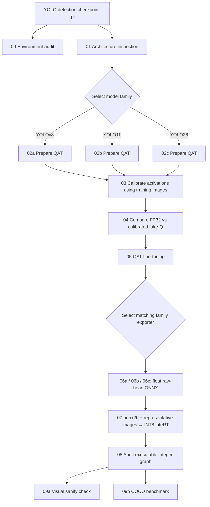

# YOLO Quantization-Aware Training → Raw-Head ONNX → LiteRT INT8

> **Installation guide, end-to-end usage instructions, validation workflow, and source-code reference**  
> Scope: **object detection** with **YOLOv8, YOLO11, and YOLO26** (Ultralytics).  
> This guide is based on the **20 Python files included in this project**. It does not claim that end-to-end training or conversion has been successfully tested on any specific machine.

## Table of Contents

1. [Introduction and Supported Scope](#1-introduction-and-supported-scope)
2. [Pipeline Overview](#2-pipeline-overview)
3. [Repository Structure and File Naming](#3-repository-structure-and-file-naming)
4. [System Requirements and Environment Setup](#4-system-requirements-and-environment-setup)
5. [Preparing Checkpoints and Datasets](#5-preparing-checkpoints-and-datasets)
6. [Running the Complete Pipeline](#6-running-the-complete-pipeline)
7. [Detailed Explanation of Every Source File](#7-detailed-explanation-of-every-source-file)
8. [Data Formats and Intermediate Artifacts](#8-data-formats-and-intermediate-artifacts)
9. [Understanding Validation Statuses](#9-understanding-validation-statuses)
10. [Troubleshooting](#10-troubleshooting)
11. [Reproducibility and Git Best Practices](#11-reproducibility-and-git-best-practices)
12. [Current Limitations and References](#12-current-limitations-and-references)

---

## 1. Introduction and Supported Scope

This repository provides a **Quantization-Aware Training (QAT)** pipeline for selected YOLO object-detection architectures. After QAT, it exports the model's **raw detection head** to ONNX, converts it into a **full-integer INT8 LiteRT/TFLite** model, inspects the quantized graph, performs visual inference checks, and evaluates detection performance using COCOeval.

The main technologies are:

- **Ultralytics:** loads YOLO checkpoints, inspects architectures, trains models, and evaluates detections.
- **PyTorch:** implements model execution, backpropagation, and weight serialization.
- **NVIDIA Model Optimizer (ModelOpt):** inserts quantizers to simulate quantization during QAT.
- **ONNX and ONNX Runtime:** export and compare raw-head ONNX outputs against PyTorch.
- **onnx2tf:** applies representative-data quantization to convert ONNX to INT8 LiteRT/TFLite.
- **AI Edge LiteRT Interpreter:** audits and runs the resulting INT8 model.
- **OpenCV, NumPy, and pycocotools:** preprocess images, decode predictions, draw bounding boxes, and perform COCO evaluation.

### 1.1. Architecture-specific entry points

| Model family | QAT preparation entry point | ONNX export entry point | Regression head | Default postprocessing |
|---|---|---|---|---|
| YOLOv8 | `02a_prepare_qat_yolov8.py` | `06a_export_raw_yolov8.py` | DFL, `reg_max > 1`; non-end-to-end head | Class-aware NMS |
| YOLO11 | `02b_prepare_qat_yolo11.py` | `06b_export_raw_yolo11.py` | DFL, `reg_max > 1`; non-end-to-end head | Class-aware NMS |
| YOLO26 | `02c_prepare_qat_yolo26.py` | `06c_export_raw_yolo26.py` | `reg_max = 1`, no DFL; two head branches | `one2many` → NMS; `one2one` → top-k |

**Note:** `01_inspect_model.py` can assign `yolov10` or `custom` labels for *inspection purposes*. The project does **not** include corresponding QAT/export entry points for these families. A checkpoint filename alone does not prove architectural compatibility: the scripts inspect the actual detection head.

### 1.2. An important distinction: “QAT → INT8”

This pipeline **does not directly export ModelOpt's learned quantization scales as a preserved Q/DQ ONNX graph**. In `qat_export_common.py`, ModelOpt fake quantizers are **disabled during ONNX export**. The actual process is:

1. **Step 05:** fine-tune the weights using fake quantization (QAT).
2. **Step 06:** export a **floating-point ONNX model using QAT-trained weights**, producing raw regression and classification logits.
3. **Step 07:** run **representative-data post-training quantization (PTQ)** through `onnx2tf` to obtain an INT8 model.
4. **Steps 08–09:** audit the integer graph, run inference, and measure the performance of the **actual LiteRT artifact**.

Therefore, Step 06 should **not** be described as an "INT8 ONNX export preserving QAT scales." A more accurate description is **QAT-trained weights + float ONNX export + representative-data INT8 conversion**.

---

## 2. Pipeline Overview



The following shared modules are **not standalone pipeline stages**:

- `qat_prepare_common.py`: prepares QAT topology and reconstructs the graph when needed.
- `qat_stage_common.py`: manages checkpoints, metadata validation, metrics, logging, and shared stage utilities.
- `qat_export_common.py`: implements the shared ONNX exporter for Steps 06a/06b/06c.
- `raw_head_postprocess.py`: implements raw-output decoding, letterboxing, and INT8 I/O helpers.
- `raw_litert_runner.py`: loads an audited model and runs detection for Steps 09a/09b.

**General rule:** keep the base checkpoint, image dimensions, model family, and run directory consistent throughout a single experiment. Use a **separate `prepared-dir` for every checkpoint/family**.

---

## 3. Repository Structure and File Naming

### 3.1. Recommended GitHub repository layout

```text
yolo-qat-litert/
├── README.md
├── README_EN.md
├── 00_environment_audit.py
├── 01_inspect_model.py
├── 02a_prepare_qat_yolov8.py
├── 02b_prepare_qat_yolo11.py
├── 02c_prepare_qat_yolo26.py
├── 03_calibrate_activations.py
├── 04_pretrain_validation.py
├── 05_train_qat.py
├── 06a_export_raw_yolov8.py
├── 06b_export_raw_yolo11.py
├── 06c_export_raw_yolo26.py
├── 07_convert_raw_litert_int8.py
├── 08_audit_raw_litert.py
├── 09a_sanity_raw_litert.py
├── 09b_benchmark_raw_litert_coco.py
├── qat_prepare_common.py
├── qat_stage_common.py
├── qat_export_common.py
├── raw_head_postprocess.py
├── raw_litert_runner.py
├── models/                 # User-provided or separately downloaded .pt checkpoints
├── datasets/               # User-prepared images, labels, annotations, manifests
└── runs/                   # Generated logs, checkpoints, ONNX, TFLite, metrics
```

All filenames in this tree have been **normalized**. Some original attachments were downloaded with `(1)` or `(2)` suffixes because of duplicate filenames. **Rename them before running the pipeline**, especially:

| Original downloaded name | Required repository filename |
|---|---|
| `00_environment_audit(1).py` | `00_environment_audit.py` |
| `01_inspect_model(1).py` | `01_inspect_model.py` |
| `02a_prepare_qat_yolov8(1).py` | `02a_prepare_qat_yolov8.py` |
| `02b_prepare_qat_yolo11(1).py` | `02b_prepare_qat_yolo11.py` |
| `02c_prepare_qat_yolo26(1).py` | `02c_prepare_qat_yolo26.py` |
| `03_calibrate_activations(2).py` | `03_calibrate_activations.py` |
| `09b_benchmark_raw_litert_coco(2).py` | `09b_benchmark_raw_litert_coco.py` |
| `qat_prepare_common(1).py` | `qat_prepare_common.py` |

**Why this matters:** the scripts use imports such as `from qat_prepare_common import ...`. Python will **not** treat `qat_prepare_common(1).py` as the `qat_prepare_common` module. Failing to rename it can cause `ModuleNotFoundError` in Steps 02–06.

### 3.2. Why all scripts and helpers share one directory

The source files use direct module imports, for example:

```python
from qat_stage_common import restore_qat_from_artifact
from raw_head_postprocess import read_metadata
```

The current layout is **not an installed Python package with `__init__.py`**. All commands below assume execution from the **repository root**, with the Python files at the same level. Do not move individual helpers into a different directory without updating their imports.

---

## 4. System Requirements and Environment Setup

### 4.1. Hardware, operating system, and compatibility considerations

- **An NVIDIA GPU and a CUDA-compatible driver** are strongly recommended for QAT. `--device auto` selects CUDA when available. Some stages can run on CPU, but training may be extremely slow.
- **VRAM/RAM requirements:** the code does not define a guaranteed minimum. Requirements depend on model scale (`n/s/m/l/x`), `--imgsz`, `--batch`, datasets, and library versions. If you encounter out-of-memory errors, start with a small model and reduce batch size.
- **Linux or Ubuntu on WSL2 is recommended for CUDA QAT** if native Windows encounters PyTorch/ModelOpt compatibility problems. This is an operational recommendation, not a tested source-code requirement.
- Install Python, `pip`, `venv`, and optionally Git.
- **Two separate Python virtual environments are recommended** because PyTorch/ModelOpt and TensorFlow/onnx2tf may have conflicting dependencies.

> **Versioning note:** the 20 supplied source files do **not** include a `requirements.txt`, dependency lockfile, or verified version-compatibility matrix. The commands below are **initial installation examples inferred from imports and package documentation**—not proof that arbitrary latest versions work together. Once the pipeline works, capture the exact versions using `pip freeze`.

### 4.2. Dependencies by stage

| Python package | Used for | Environment |
|---|---|---|
| `torch`, `torchvision` | YOLO/PyTorch/QAT/training/export | QAT |
| `ultralytics` | YOLO checkpoints/trainer/validator | QAT |
| `nvidia-modelopt` | `modelopt.torch.quantization` | QAT |
| `numpy`, `opencv-python` | Image processing/calibration/tensor comparisons | Both |
| `PyYAML` | Reading and validating `dataset.yaml` | QAT |
| `onnx`, `onnxruntime` | Step 06 ONNX validation | QAT |
| `onnx2tf` | CLI for ONNX → INT8 TFLite/LiteRT conversion | Convert/runtime |
| `tensorflow`, `tf-keras` | `tf_converter` backend explicitly selected in Step 07 | Convert/runtime |
| `ai-edge-litert` | INT8 interpreter, graph auditing, inference | Convert/runtime |
| `pycocotools` | Step 09b COCO evaluation | Convert/runtime |

Standard-library modules including `argparse`, `hashlib`, `pathlib`, `subprocess`, `json`, `logging`, and `dataclasses` do **not** require separate installation.

### 4.3. Environment A — QAT, training, and ONNX export

**Linux / WSL2 example:**

```bash
# Run from the repository root.
python3.11 -m venv .venv-qat
source .venv-qat/bin/activate
python -m pip install --upgrade pip setuptools wheel

# Install torch + torchvision for your actual CUDA/CPU configuration.
# Official selector: https://pytorch.org/get-started/locally/
# Example only; CUDA 12.6 is NOT universally correct for every GPU/driver:
# python -m pip install torch torchvision --index-url https://download.pytorch.org/whl/cu126

python -m pip install ultralytics nvidia-modelopt numpy opencv-python pyyaml onnx onnxruntime
python -m pip check
```

**Windows PowerShell example** (Python 3.11 and a compatible PyTorch build required):

```powershell
py -3.11 -m venv .venv-qat
.\.venv-qat\Scripts\Activate.ps1
python -m pip install --upgrade pip setuptools wheel
# Install torch + torchvision according to https://pytorch.org/get-started/locally/
python -m pip install ultralytics nvidia-modelopt numpy opencv-python pyyaml onnx onnxruntime
python -m pip check
```

If PowerShell prevents virtual-environment activation, run `\.venv-qat\Scripts\python.exe` directly instead of changing system-wide execution policies.

**Verify imports and GPU availability:**

```bash
python -c "import torch; print('torch=',torch.__version__, 'CUDA=',torch.cuda.is_available())"
python -c "from ultralytics import YOLO; import modelopt.torch.quantization as mtq; print('ModelOpt API:', hasattr(mtq,'INT8_DEFAULT_CFG'))"
python 00_environment_audit.py --device auto
# Require a working GPU:
python 00_environment_audit.py --device cuda:0 --require-cuda
```

Before starting QAT, inspect `runs/qat/preflight/00_environment_audit.json` and confirm that `"status": "PASS"`. Passing preflight checks only validates imports, basic APIs/GPU functionality, and a small Conv2d operation. It **does not guarantee checkpoint compatibility or successful INT8 conversion**.

### 4.4. Environment B — `onnx2tf`, LiteRT, and COCOeval

The original guide notes that newer `onnx2tf` releases may require **Python 3.12 or newer**. This example uses Python 3.12 for the converter, but you must verify the actual requirements of the release you install.

**Linux / WSL2:**

```bash
deactivate  # If .venv-qat is active
python3.12 -m venv .venv-convert
source .venv-convert/bin/activate
python -m pip install --upgrade pip setuptools wheel
python -m pip install onnx2tf tensorflow tf-keras ai-edge-litert numpy opencv-python pycocotools
python -m pip check
onnx2tf -h
python -c "from ai_edge_litert.interpreter import Interpreter; import cv2; from pycocotools.coco import COCO; print('LiteRT/COCO imports OK')"
```

**Windows PowerShell:**

```powershell
py -3.12 -m venv .venv-convert
.\.venv-convert\Scripts\Activate.ps1
python -m pip install --upgrade pip setuptools wheel
python -m pip install onnx2tf tensorflow tf-keras ai-edge-litert numpy opencv-python pycocotools
python -m pip check
onnx2tf -h
```

If the converter reports missing modules, follow the dependency list for the specific installed `onnx2tf` release. Step 07 calls `-tb tf_converter`, so **TensorFlow must not be assumed optional for this pipeline**.

> Step 07 executes the **`onnx2tf` CLI from `PATH`**. Make sure `onnx2tf -h` works in the *active environment*. Step 08 uses the internal method `Interpreter._get_ops_details()`; this private API can change between LiteRT releases and should be version-pinned once verified.

### 4.5. Record exact environment versions

After verifying both environments:

```bash
# Inside the QAT environment:
python -m pip freeze > requirements-qat.lock.txt

# After activating the converter environment:
python -m pip freeze > requirements-convert.lock.txt
```

These lockfiles are **generated on your tested machine**; they were not part of the supplied source files. Commit them once a working dependency combination is established, and also record GPU, driver, OS, and Step 00 audit information.

---

## 5. Preparing Checkpoints and Datasets

### 5.1. YOLO `.pt` checkpoints

Example directory:

```text
models/
├── yolov8n.pt
├── yolo11n.pt
└── yolo26n.pt
```

Checkpoints must be **Ultralytics object-detection checkpoints** with heads matching the selected family. Users must obtain or provide the checkpoints: the repository **does not bundle pretrained weights or download datasets**.

A run operates on **one checkpoint** (e.g., `models/yolov8n.pt`). Commands below mainly demonstrate YOLOv8. For YOLO11/YOLO26, select the corresponding `02x` and `06x` scripts.

### 5.2. Ultralytics dataset for Steps 04/05

Illustrative **two-class** dataset:

```text
datasets/my_dataset/
├── dataset.yaml
├── images/
│   ├── train/
│   └── val/
└── labels/
    ├── train/
    └── val/
```

Example `datasets/my_dataset/dataset.yaml`:

```yaml
path: datasets/my_dataset
train: images/train
val: images/val
nc: 2
names:
  0: class_A
  1: class_B
```

**Do not use this two-class example unchanged with an 80-class COCO checkpoint.** `qat_stage_common.validate_dataset_classes()` checks that the dataset's class count (`nc` or the length of `names`) matches the **existing detection head**. An 80-class model requires a compatible 80-class dataset or a **checkpoint with an appropriately adapted head** before Step 02.

Ultralytics detection labels contain one entry per line, `class_id x_center y_center width height`, using normalized coordinates. Confirm that Ultralytics can resolve the `train` and `val` paths in your YAML correctly.

### 5.3. Calibration images for Step 03

- Use **training images only**. Do not mix validation/test images into calibration when you intend to report an unbiased evaluation.
- Choose **exactly one** of the following input modes:
  - `--calib-images datasets/my_dataset/images/train`: recursively discover `.jpg`, `.jpeg`, `.png`, `.bmp`, and `.webp`; randomly sample without replacement using `--seed`.
  - `--calib-manifest datasets/manifests/train_calib.txt --dataset-root .`: read paths line by line, ignore blank/comment lines, then sample deterministically using the seed.
- Default `--calib-samples` is **64**; provide at least 64 images unless you lower it.
- Implemented preprocessing: **BGR → RGB, letterbox with fill value 114, CHW, float32 in `[0,1]`**.

Example manifest:

```text
# One image path per line; relative paths use --dataset-root.
datasets/my_dataset/images/train/img0001.jpg
datasets/my_dataset/images/train/img0002.jpg
datasets/my_dataset/images/train/img0003.jpg
```

### 5.4. Representative images for Step 07

`07_convert_raw_litert_int8.py` requires **exactly one** of these:

- `--calib-manifest ... --dataset-root ... --calib-samples 64`: generate `07_representative_nhwc_float32.npy`.
- `--calib-npy data/calibration.npy`: load an existing NumPy array.

Required `.npy` format: **float32**, **NHWC `[N,H,W,3]`**, values in `[0,1]`, with no NaNs or infinities. For `imgsz=640`, an example shape is `(64, 640, 640, 3)`.

**Difference from Step 03:** Step 03 feeds **NCHW tensors to PyTorch**, while Step 07 saves representative images as **NHWC** for `onnx2tf` quantization.

### 5.5. Evaluation data for Step 09

**Visual sanity check (`09a`):** requires only an image manifest and `--dataset-root`.

**COCO benchmark (`09b`):** additionally requires a COCO-format `instances_*.json` file. Its image IDs and category IDs must correspond to the benchmark images. The script matches images to annotations by **unique filename** and rejects missing or ambiguous names.

- With standard **COCO 80-class models**, the script contains the `COCO80_TO_91` category mapping, subject to a compatible annotation category list.
- With a **custom dataset**, supply an explicit `--class-map` JSON mapping `class_index -> COCO category_id`.

Example for a two-class checkpoint when annotations use category IDs 3 and 7:

```json
{"0": 3, "1": 7}
```

**Do not guess COCO category IDs from class names.** Use the actual category IDs from your annotation file.

---
## 6. Running the Complete Pipeline

All commands assume execution from the **repository root** and normalized script filenames. Example paths:

```text
MODEL=models/yolov8n.pt
RUN=runs/qat/yolov8n
DATA=datasets/my_dataset/dataset.yaml
CALIB=datasets/manifests/train_calib.txt
VAL_MANIFEST=datasets/manifests/val_subset.txt
ANNOTATIONS=datasets/my_dataset/annotations/instances_val.json
```

Replace `MODEL`, `DATA`, and `ANNOTATIONS` with paths that exist on your machine. `RUN` is an example working directory, created as needed. The variable declarations above are only explanatory; the commands below already contain concrete example paths.

### Step 00 — Audit the environment

**Environment: `.venv-qat`.**

```bash
python 00_environment_audit.py --device cuda:0 --require-cuda --output runs/qat/preflight
```

- **Input:** installed dependencies and the selected compute device.
- **Checks:** Python/PyTorch/Ultralytics/ModelOpt versions, CUDA/cuDNN, ModelOpt imports, and a small `Conv2d` compute test.
- **Outputs:** `runs/qat/preflight/00_environment_audit.json` and `.log`.
- **Proceed when:** JSON contains `status = PASS`. On a CPU-only machine, you may try `--device cpu` without `--require-cuda`.

### Step 01 — Inspect the checkpoint

```bash
python 01_inspect_model.py \
  --model models/yolov8n.pt \
  --family yolov8 \
  --device cpu \
  --output runs/qat/yolov8n/inspect
```

- **Input:** the `.pt` checkpoint.
- **Outputs:** `runs/qat/yolov8n/inspect/01_model_info.json` and log.
- **Inspect:** `task`, `nc`, `parameters`, `conv2d_modules`, `head_candidates`, `reg_max`, `stride`, and `end2end`.
- **Note:** `--family auto` is only a filename-based hint. Specify the model family explicitly for custom-renamed checkpoints.

### Step 02 — Prepare the QAT graph for the selected family

**Run exactly one of the following family-specific commands.**

**YOLOv8:**

```bash
python 02a_prepare_qat_yolov8.py \
  --model models/yolov8n.pt \
  --output runs/qat/yolov8n \
  --imgsz 640 \
  --device cuda:0 \
  --sanity-forward
```

**YOLO11:**

```bash
python 02b_prepare_qat_yolo11.py \
  --model models/yolo11n.pt \
  --output runs/qat/yolo11n \
  --imgsz 640 --device cuda:0 --sanity-forward
```

**YOLO26:**

```bash
python 02c_prepare_qat_yolo26.py \
  --model models/yolo26n.pt \
  --output runs/qat/yolo26n \
  --imgsz 640 --device cuda:0 --sanity-forward
```

- **Operation:** invoke ModelOpt `mtq.quantize()`, inspect the quantizers attached to every `Conv2d`, and change quantizer placement for `Conv → BN → activation` wrappers to use **post-activation fake quantization**.
- **YOLO26:** checks for both `one2many` and `one2one` branches and enables dual-head mode as required.
- **YOLOv8 outputs:** `02a_prepare_qat_yolov8_quant_audit.json`, `02a_prepare_qat_yolov8_prepared_state_dict.pt`, and a log. YOLO11 and YOLO26 use their corresponding `02b`/`02c` prefixes.
- **Proceed when:** `STRUCTURAL_PASS` is reported and the `*_prepared_state_dict.pt` file exists.
- **Do not use `--no-save-state`** if you intend to continue to Step 03. That option is intended for standalone structural audits.
- `--imgsz` accepts either one number (square image) or two numbers `H W`, with both dimensions divisible by **32**. However, the current Step 04/05 implementations require **square images**. Use `--imgsz 640` for the complete example workflow.

> `STRUCTURAL_PASS` means only that quantizers have been inserted and placed according to the implemented policy. It does **not** prove successful calibration, QAT training, or INT8 export.

### Step 03 — Calibrate activation quantizers

```bash
python 03_calibrate_activations.py \
  --prepared-dir runs/qat/yolov8n \
  --calib-images datasets/my_dataset/images/train \
  --calib-samples 64 \
  --device cuda:0 \
  --seed 42
```

Or supply an image manifest:

```bash
python 03_calibrate_activations.py \
  --prepared-dir runs/qat/yolov8n \
  --calib-manifest datasets/manifests/train_calib.txt \
  --dataset-root . \
  --calib-samples 64 \
  --device cuda:0
```

- **Inputs:** the Step 02 prepared state and representative **training** images.
- **Internals:** reconstruct the exact QAT topology, collect statistics from active **activation quantizers**, run calibration forwards, load updated `_amax` values, re-enable quantization, and check that `_amax` values are positive and finite.
- **Outputs:** `03_calibrated_state_dict.pt`, `03_calibration_images.txt`, `03_calibrate_activations.json`, and a log.
- **Proceed when:** `CALIBRATION_PASS` is reported.
- `--no-sanity-forward` skips only the additional finite-value forward check after calibration.

**Important:** if you redirect `--output` to a different directory, later stages still look for `03_calibrated_state_dict.pt` under `--prepared-dir` by default. Provide `--calibrated-checkpoint` explicitly if necessary. For the first run, **keep outputs in the prepared directory**.

### Step 04 — Validate FP32 vs calibrated fake-Q before training

```bash
python 04_pretrain_validation.py \
  --prepared-dir runs/qat/yolov8n \
  --data datasets/my_dataset/dataset.yaml \
  --batch 8 \
  --device cuda:0 \
  --workers 0 \
  --conf 0.001 --iou 0.7 --max-det 300
```

- **Inputs:** the original FP32 checkpoint, the Step 03 calibrated fake-Q state, and the YAML validation split.
- **Operation:** evaluate the FP32 model through `YOLO(...).val()`, then validate the calibrated fake-Q model under the same settings, using Ultralytics metrics.
- **Outputs:** `04_pretrain_validation.json` and log.
- **Metrics:** `map50`, `map50_95`, `precision`, `recall`, and absolute/relative changes.
- **Proceed when:** `VALIDATION_PASS` is reported.

**Metric comparability:** Step 04 uses the **Ultralytics validator**, whereas Step 09b uses **pycocotools COCOeval**. Comparisons are meaningful only when dataset/split, preprocessing, confidence threshold, IoU threshold, maximum detections, and metric definitions are aligned.

### Step 05 — QAT fine-tuning

```bash
python 05_train_qat.py \
  --prepared-dir runs/qat/yolov8n \
  --data datasets/my_dataset/dataset.yaml \
  --epochs 50 \
  --batch 8 \
  --lr 1e-5 \
  --optimizer AdamW \
  --weight-decay 1e-4 \
  --device cuda:0 \
  --workers 0 \
  --validate-after
```

- **Inputs:** the Step 03 calibrated checkpoint, a dataset YAML with `train`/`val`, and the original checkpoint needed for QAT topology reconstruction.
- **Operation:** subclass `ultralytics.models.yolo.detect.DetectionTrainer`, preserve the injected ModelOpt quantizers during training, use `amp=False`, **freeze BatchNorm running statistics by default**, and **disable augmentation by default**.
- **Typical defaults:** `epochs=50`, `batch=8`, `lr=1e-5`, `lrf=1.0`, `weight_decay=1e-4`, `optimizer=AdamW`, and `warmup_epochs=0`.
- Enable standard augmentation with `--augment`, or allow BatchNorm statistics to change with `--update-bn`.
- `--validate-after` runs the validator after fine-tuning and can compare metrics with a valid Step 04 baseline.
- **Outputs:** `05_qat_trained_state_dict.pt`, `05_train_qat.json`, a log, and a separate Ultralytics trainer results directory.
- **Proceed when:** `TRAINING_PASS` is reported and `05_qat_trained_state_dict.pt` exists.

**Fine-tuning from a previous Step 05 weight checkpoint:**

```bash
python 05_train_qat.py \
  --prepared-dir runs/qat/yolov8n \
  --data datasets/my_dataset/dataset.yaml \
  --init-checkpoint runs/qat/yolov8n/05_qat_trained_state_dict.pt \
  --epochs 10 --batch 8 --lr 1e-6 --device cuda:0
```

`--init-checkpoint` restores **weights and QAT state only**; it does **not resume optimizer or scheduler state**. Each run creates a fresh optimizer and scheduler. Reusing the same output path can overwrite earlier weights, so **back up the checkpoint or use a separate `--output` directory**, and ensure downstream stages use the intended weight file.

### Step 06 — Export raw-head ONNX (matching model family)

**YOLOv8:**

```bash
python 06a_export_raw_yolov8.py \
  --prepared-dir runs/qat/yolov8n \
  --device cpu \
  --opset 13
```

**YOLO11:**

```bash
python 06b_export_raw_yolo11.py \
  --prepared-dir runs/qat/yolo11n \
  --device cpu --opset 13
```

**YOLO26**, select a head branch:

```bash
python 06c_export_raw_yolo26.py \
  --prepared-dir runs/qat/yolo26n \
  --device cpu --opset 13 \
  --head-branch one2many
```

Alternatively, use `--head-branch one2one` for end-to-end/top-k behavior. The default YOLO26 branch is **`one2many`**.

- **Input:** `05_qat_trained_state_dict.pt` (or another checkpoint explicitly supplied through `--checkpoint`, with valid metadata).
- **Internals:** restore the QAT-trained model; disable fake quantizers; extract raw regression and classification outputs before DFL/sigmoid/anchor decoding; compare PyTorch and ONNX Runtime outputs; verify host-side decoding against the PyTorch reference.
- **Outputs:** `06_raw_head.onnx`, `06_raw_head_export.json`, `06_raw_head_metadata.json`, and log.
- **Proceed when:** `EXPORT_PASS` is reported and metadata declares the `raw_reg_cls_v1` contract.

The exported ONNX graph has **one input** named `images` and **two outputs** named `reg_logits` and `cls_logits`. These are **not final decoded bounding boxes**, and **NMS is not part of this graph**.

### Step 07 — Convert ONNX to INT8 LiteRT

**Activate `.venv-convert`** before this step:

```bash
# Linux/WSL2 example:
deactivate
source .venv-convert/bin/activate
onnx2tf -h
```

Convert from an image manifest:

```bash
python 07_convert_raw_litert_int8.py \
  --prepared-dir runs/qat/yolov8n \
  --calib-manifest datasets/manifests/train_calib.txt \
  --dataset-root . \
  --calib-samples 64
```

Or use a prepared representative `.npy` file:

```bash
python 07_convert_raw_litert_int8.py \
  --prepared-dir runs/qat/yolov8n \
  --calib-npy datasets/representative_nhwc_float32.npy
```

- **Inputs:** verified `06_raw_head.onnx`, Step 06 metadata, and representative images/NPY.
- **Internals:** start the `onnx2tf` subprocess with arguments including `-tb tf_converter -oiqt -iqd int8 -oqd int8 -cind images ...`. Representative images are letterboxed and normalized to `[0,1]`.
- **Outputs:** `07_litert_int8/` containing a `*full_integer_quant.tflite` file, `07_convert_raw_litert_int8.json`, `07_onnx2tf_convert.log`, and potentially `07_representative_nhwc_float32.npy`.
- **Proceed when:** `CONVERSION_PASS` is reported.
- The script refuses to overwrite a **nonempty** conversion directory. Use `--force` only when you **intentionally want to delete and regenerate the conversion output directory**.

`CONVERSION_PASS` **does not prove that all executable neural-network operators use INT8**. Step 08 performs that audit.

### Step 08 — Audit the full-integer LiteRT graph

**Environment: `.venv-convert` (with `ai-edge-litert`).**

```bash
python 08_audit_raw_litert.py \
  --prepared-dir runs/qat/yolov8n \
  --threads 1
```

- **Inputs:** the generated `.tflite` file and provenance/SHA256 information from Steps 06–07.
- **Checks:** exactly one INT8 input and two INT8 outputs; quantization parameters; operators reachable from graph outputs; live tensor dtypes; banned operators including `DEQUANTIZE`, `CUSTOM`, `Flex*`, and `DELEGATE`; INT8 convolution and INT32 bias requirements according to the implemented policy.
- **Output:** `08_audit_raw_litert.json`.
- **Proceed when:** `STRUCTURAL_PASS` is reported with `violations=[]`.

Some shape/index tensors may legitimately use `int32` or `int64`. Here, "full INT8" describes the **neural-network data computation path**, not necessarily every metadata tensor in the graph.

### Step 09a — Visual sanity checks on real images

```bash
python 09a_sanity_raw_litert.py \
  --prepared-dir runs/qat/yolov8n \
  --manifest datasets/manifests/val_subset.txt \
  --dataset-root . \
  --num-images 5 \
  --conf 0.25 --iou 0.45 \
  --method auto --threads 1
```

- **Inputs:** the model that passed Steps 07 and 08, plus an image manifest.
- **Flow:** letterbox → quantize INT8 input → LiteRT `invoke()` → dequantize outputs on the host → decode the raw head → NMS/top-k → draw bounding boxes.
- **Outputs:** `09a_sanity_images/` containing annotated images and `sanity_report.json`.
- **Pass condition in the code:** at least **one detection across all tested images**. This is **not** an accuracy benchmark. If the step reports `FUNCTIONAL_FAIL`, lower `--conf` and inspect preprocessing, inputs, and model predictions.
- With `--method auto`, the runner chooses `topk` for YOLO26 `one2one` and `nms` for the other branches.

### Step 09b — COCOeval benchmark

```bash
python 09b_benchmark_raw_litert_coco.py \
  --prepared-dir runs/qat/yolov8n \
  --manifest datasets/manifests/val_subset.txt \
  --dataset-root . \
  --annotations datasets/my_dataset/annotations/instances_val.json \
  --num-images 1000 \
  --conf 0.001 --iou 0.7 \
  --max-det 300 --method auto --threads 1
```

**For a nonstandard/custom COCO dataset**, add the following argument **to the same command**:

```bash
  --class-map datasets/my_dataset/class_to_category_id.json
```

**For an optional accuracy acceptance gate**, supply **both** thresholds (the values below are illustrations; select thresholds suitable for your project):

```bash
  --min-map50 0.50 --min-map50-95 0.30
```

The individual `--class-map` and `--min-map50` lines shown above are **arguments to append to the benchmark command**, not standalone shell commands.

- **Inputs:** verified model, a manifest containing **exactly** `--num-images` images (default 1000), COCO annotations, and an optional class map.
- **Outputs:** `09b_coco_predictions.json` with COCO-format detections and `09b_coco_metrics.json` with AP/mAP, image and detection counts, `invoke_ms` latency statistics, and model file size.
- **Without thresholds:** `EVALUATION_PASS` means the evaluation **completed successfully**; it does **not** mean that model quality met an acceptance target.
- **With both thresholds:** `ACCURACY_PASS` means both were achieved; otherwise, `ACCURACY_FAIL` is reported.

**COCOeval detail:** Step 09b recomputes **overall AP50–95** from the `precision` tensor using the configured `max_det`. This avoids potential `COCOeval.summarize()` results of `-1` for `stats[0]` when using `maxDets=[1,10,300]` rather than `100`. Other reported statistics still follow the implementation's COCOeval object.

### 6.1. Family-specific command summary

| Stage | YOLOv8 | YOLO11 | YOLO26 |
|---|---|---|---|
| Prepare | `02a_prepare_qat_yolov8.py` | `02b_prepare_qat_yolo11.py` | `02c_prepare_qat_yolo26.py` |
| Calibrate | `03_calibrate_activations.py` | Same as YOLOv8 | Same as YOLOv8 |
| Pretrain validation | `04_pretrain_validation.py` | Same as YOLOv8 | Same as YOLOv8 |
| Train | `05_train_qat.py` | Same as YOLOv8 | Same as YOLOv8 |
| Export | `06a_export_raw_yolov8.py` | `06b_export_raw_yolo11.py` | `06c_export_raw_yolo26.py` |
| Convert/audit/inference | `07` → `08` → `09a`/`09b` | Same as YOLOv8 | Same as YOLOv8 |

---
## 7. Detailed Explanation of Every Source File

This section documents the **purpose, main functions, code dependencies, and outputs** of all **20 provided Python files**.

### 7.1. `00_environment_audit.py` — environment preflight

- **Purpose:** check the environment before loading a model checkpoint. Does not depend on any custom helper module.
- **Main functions:** `parse_args()`, `version_of()`, `setup_logger()`, `run()`.
- **Built upon:** `importlib.metadata`, `platform`, `torch`, `from ultralytics import YOLO`, and `importlib.import_module('modelopt.torch.quantization')`.
- **Implementation:** inventory GPU devices and compute capability; collect CUDA/cuDNN information; confirm ModelOpt exposes `quantize` and `INT8_DEFAULT_CFG`; create a random tensor and run `torch.nn.Conv2d` on the selected device.
- **Artifacts:** `00_environment_audit.json` and `.log`; `PASS` or `FAIL`.
- **Does not:** validate YOLO architecture, train models, or convert to LiteRT.

### 7.2. `01_inspect_model.py` — checkpoint architecture inventory

- **Purpose:** load an Ultralytics detection checkpoint and produce a structural inventory.
- **Main functions:** `family_hint()`, `inspect()`, `main()`.
- **Built upon:** `YOLO(str(args.model), task='detect')`, `raw.named_modules()`, `torch.nn.Conv2d`, and head attributes `nc`, `reg_max`, `stride`, `end2end`, `one2one_cv2/one2one_cv3`.
- **Implementation:** count convolution modules; record kernel sizes, groups, input/output channels, detection-head candidates, and parameter counts. Automatic family detection uses a filename regex and is **only a hint**.
- **Artifacts:** `01_model_info.json` and `.log`.
- **Does not:** perform full ModelOpt compatibility or INT8 converter validation.

### 7.3. `02a_prepare_qat_yolov8.py` — YOLOv8 preparation entry point

- **Purpose:** provide a thin adapter for YOLOv8 detection heads with DFL.
- **Main functions:** `prepare_qat_yolov8()` calls `qat_prepare_common.prepare_qat(..., family='yolov8')`. The `__main__` block dispatches through `main_for_family(build_parser('yolov8'), ...)`.
- **Depends on:** `qat_prepare_common.py`; **does not implement its own quantizer insertion algorithm**.
- **Output prefix:** `02a_prepare_qat_yolov8_*`.

### 7.4. `02b_prepare_qat_yolo11.py` — YOLO11 preparation entry point

- **Purpose:** select `family='yolo11'` and reuse the common preparation implementation.
- **Main functions:** `prepare_qat_yolo11()`, `main_for_family()`.
- **Depends on:** `qat_prepare_common.py`.
- **Head assumptions:** detection head with `reg_max > 1`, no end-to-end mode, and no `one2one` branch.
- **Important:** the code handles/inspects YOLO11 Conv/DWConv blocks, but attention modules (such as C2PSA) **are not certified as INT8-compatible by Step 02 alone**.

### 7.5. `02c_prepare_qat_yolo26.py` — YOLO26 preparation entry point

- **Purpose:** select `family='yolo26'` and prepare dual-head QAT.
- **Main functions:** `prepare_qat_yolo26()`, `main_for_family()`.
- **Depends on:** `qat_prepare_common.prepare_qat()` and `ensure_yolo26_dual_head()`.
- **Head assumptions:** `reg_max == 1`, `end2end=True`, and complete `cv2/cv3` plus `one2one_cv2/one2one_cv3` branches. Missing pretrained weights are **not synthesized**.
- **Output prefix:** `02c_prepare_qat_yolo26_*`.

### 7.6. `qat_prepare_common.py` — core quantizer placement implementation

This module is the **core of Step 02** and is reused to reconstruct the same QAT graph in later stages.

- **`PostActQuant(nn.Module)`:** wrapper whose forward computes `output_quantizer(activation(x))`.
- **`build_modelopt_int8()`:** copy `mtq.INT8_DEFAULT_CFG`, require `quant_cfg` to be represented as a list, and call `mtq.quantize(model, cfg, forward_loop)` with a dummy input.
- **`apply_post_activation_policy()`:** inspect ModelOpt-instrumented convolution layers. In verified `Conv → BN → Act` wrappers, disable the original Conv/BN output quantizer and place quantization **after activation**. For standalone `Conv2d` layers, enable the convolution's own output quantizer.
- **`trusted_wrapper()`:** automatically trust only Ultralytics `Conv`/`DWConv` wrappers. Multi-branch blocks such as `Conv2`/`RepConv` are not accepted as simple wrappers without specialized handling. `--allow-custom-wrappers` is **not a blanket bypass for all checks**.
- **`find_detect_head()`**, **`validate_detection_head()`**, **`ensure_yolo26_dual_head()`:** verify real detection-head structure, family assumptions, DFL/end-to-end settings, and branch counts.
- **`prepare_qat()`:** combine head validation, ModelOpt insertion, placement audit, and optional dummy forward.
- **`build_parser()`**, **`main_for_family()`:** provide the shared CLI and save `*_quant_audit.json`, `*_prepared_state_dict.pt`, and logs.

**Design intent:** simulate quantization **after activation** in `Conv-BN-Act` blocks and produce an auditable quantizer-coverage report. This is **not** an implementation of quantization for every YOLO operator.

### 7.7. `qat_stage_common.py` — stage state, provenance, and shared validation

Imported by Steps **03, 04, 05, and 06**.

- **`FAMILY_STEP`:** map `yolov8/yolo11/yolo26` to the correct Step 02 file prefix.
- **`load_prepared_spec()`:** find **exactly one** Step 02 audit with `STRUCTURAL_PASS`, then verify the prepared state, base checkpoint, and image size.
- **`restore_qat_from_artifact()`:** load the original checkpoint with Ultralytics, recreate the ModelOpt/placement graph from Step 02, and restore the saved state through `strict_load()`. Compare head metadata and quantizer counts to detect structural inconsistencies.
- **`strict_load()`**, **`materialize_amax_buffers()`:** restore quantizer state, recreate `_amax` buffers when necessary, and check schema/family/base SHA256 metadata.
- **`write_state()`**, **`cpu_state()`:** save checkpoints containing `schema_version`, `family`, `base_sha256`, `calib_sha256`, and `state_dict`.
- **`activation_quantizers()`**, **`validate_amax()`:** identify enabled activation quantizers and require finite, positive `_amax` values.
- **`check_calibration_meta()`:** reject checkpoints with missing calibration or mismatched model/image contract.
- **`validate_dataset_classes()`:** require the class count in `dataset.yaml` to match the model head.
- **`extract_metrics()`**, **`metric_delta()`:** extract mAP50, mAP50–95, precision, and recall, and compute metric differences.
- **`fail_closed()`:** write JSON/log information even on failure, initialize statuses as `FAIL`, and exit nonzero when validation does not pass.

**Security note:** load `.pt` checkpoints **only from trusted sources**. Ultralytics checkpoint loading and Python's pickle ecosystem should not be treated as a sandbox for untrusted model files.

### 7.8. `03_calibrate_activations.py` — activation calibration

- **Main functions:** `collect_images()`, `letterbox()`, `to_tensor()`, `_drop_stale_amax()`, `calibrate()`, `main()`.
- **Depends on:** `qat_stage_common.load_prepared_spec()`, `restore_qat_from_artifact()`, `activation_quantizers()`, and `validate_amax()`; plus NumPy, OpenCV, and PyTorch.
- **Algorithm:** sample training images → reset calibrators → `disable_quant()` and `enable_calib()` → forward each image → `disable_calib()` → remove potentially stale `_amax` values → `load_calib_amax()` → `enable_quant()`.
- **Why `_drop_stale_amax()` exists:** some ModelOpt versions register `_amax=None`, and their setter can mishandle that state when loading new calibration statistics.
- **Artifacts:** calibrated checkpoint, exact image list, calibration-data SHA256 fingerprint, and JSON quantizer statistics.
- **Does not:** update model weights through backpropagation.

### 7.9. `04_pretrain_validation.py` — controlled FP32 vs fake-Q baseline

- **Main function:** `main()`.
- **Depends on:** `qat_stage_common.restore_qat_from_artifact()`, `check_calibration_meta()`, `validate_dataset_classes()`, `extract_metrics()`, `metric_delta()`, and `ultralytics.YOLO.val()`.
- **Algorithm:** evaluate FP32 and calibrated fake-Q using the same YAML/validation split and matching `conf`, `iou`, `max_det`, `imgsz`, `batch`, and `workers`.
- **Limitation:** explicitly rejects non-square images for reproducible evaluation using the current Ultralytics validator.
- **Artifact:** `04_pretrain_validation.json` containing `fp32`, `fake_q`, `delta`, and `relative_percent`.

### 7.10. `05_train_qat.py` — QAT fine-tuning

- **Main functions:** `make_trainer()`, `no_aug_overrides()`, `main()`.
- **Depends on:** `ultralytics.models.yolo.detect.DetectionTrainer` and checkpoint/quantizer utilities in `qat_stage_common.py`.
- **`QATDetectionTrainer.get_model()`:** returns the existing QAT graph instead of rebuilding the model from a YAML file, which would discard the injected quantizers.
- **`QATDetectionTrainer.preprocess_batch()`:** sets BatchNorm modules to evaluation mode when `freeze_bn=True` to preserve running means/variances; affine parameters may still receive gradients.
- **`QATDetectionTrainer.final_eval()`:** avoids reloading `best.pt` during trainer final evaluation, preventing another ModelOpt insertion into an already-quantized object. Separate validation remains available through Step 04 or `--validate-after`.
- **Training configuration:** AMP disabled; configurable optimizer, epochs, and learning rate; augmentation off by default; `save=False` for trainer-managed checkpoints; custom serialization to `05_qat_trained_state_dict.pt` with provenance.
- **Limitations:** `--init-checkpoint` is not an optimizer/scheduler resume; square inputs are required; the Ultralytics `DetectionTrainer` API is version-sensitive and needs to be tested with pinned dependencies.

### 7.11. `06a_export_raw_yolov8.py` — YOLOv8 export launcher

- **Purpose:** a six-line launcher importing `qat_export_common.main_for_family` and calling `main_for_family('yolov8')`.
- **Does not implement:** separate ONNX export logic, decoding, or INT8 conversion.

### 7.12. `06b_export_raw_yolo11.py` — YOLO11 export launcher

- **Purpose:** call `qat_export_common.main_for_family('yolo11')`.
- **Does not implement:** an independent export policy other than selecting the model family.

### 7.13. `06c_export_raw_yolo26.py` — YOLO26 export launcher

- **Purpose:** call `qat_export_common.main_for_family('yolo26')`.
- **Family-specific behavior:** the shared exporter exposes `--head-branch one2many|one2one` for YOLO26.

### 7.14. `qat_export_common.py` — raw-head ONNX export and verification

- **`patch_raw_head()`:** temporarily replace the detection head's `forward()` to return regression (`cv2` or `one2one_cv2`) and classification (`cv3` or `one2one_cv3`) branch outputs directly. Concatenate multi-scale features into two position-indexed tensors.
- **`inspect_raw_reference()`:** use PyTorch forward hooks to capture outputs from the head branches **actually executed** by the original model, along with feature-map shapes.
- **`max_error()`:** calculate `mae` and `max_abs` between tensors and reject shape mismatches or NaN/Inf values.
- **`main_for_family()`:** restore Step 05 → disable all ModelOpt quantizers → compare patched-head PyTorch outputs with the original raw reference → validate host decoding (DFL for YOLOv8/YOLO11, `dist2bbox` for YOLO26) → call `torch.onnx.export(..., opset=13, dynamo=False)` → `onnx.checker.check_model()` → `onnxruntime.InferenceSession()` → compare ONNX and PyTorch outputs.
- **Tolerance:** `--max-abs-tol` defaults to `3e-3` for ONNX/decoding checks; the internal patch comparison uses a stricter threshold of `1e-5`.
- **Artifacts:** ONNX, verification report, and metadata covering family, branch, `reg_max`, `nc`, strides, feature shapes, and model/ONNX SHA256 hashes.
- **Important distinction:** `EXPORT_PASS` verifies the **float raw-head ONNX** and relevant host-decoding comparisons according to the code's tolerances; it is **not an INT8 acceptance result**.

### 7.15. `07_convert_raw_litert_int8.py` — ONNX to full-integer LiteRT

- **Main functions:** `representative_array()`, `validate_npy()`, `args_parser()`, `main()`.
- **Depends on:** `raw_head_postprocess.image_paths()`, `.letterbox()`, `.read_metadata()`, NumPy/OpenCV, and the `onnx2tf` CLI through `subprocess.Popen()`.
- **Algorithm:** verify the ONNX SHA256 → prepare NHWC float32 representative inputs → run `onnx2tf -oiqt -iqd int8 -oqd int8` with the `tf_converter` backend → find the `*full_integer_quant.tflite` output → record SHA256 and model size.
- **Artifacts:** `07_convert_raw_litert_int8.json`, converter log, conversion directory, and optional representative NPY.
- **Limitations:** does not audit the converted graph; refuses to overwrite a nonempty directory without `--force`.

### 7.16. `08_audit_raw_litert.py` — executable integer graph audit

- **Main functions:** `reachable_ops()`, `audit_interpreter()`, `main()`.
- **Depends on:** `raw_head_postprocess.make_interpreter()`, `.quant_params()`, Step 06 metadata, and the Step 07 JSON report.
- **Algorithm:** traverse backward from graph outputs to find operators/tensors that actually contribute to outputs, avoiding false positives from dead constants. Validate types, external quantization parameters, forbidden ops, convolution kernels, and biases.
- **Uses a private API:** `Interpreter._get_ops_details()`. If this API changes, the audit may stop working even if the model itself remains valid.
- **Artifact:** `08_audit_raw_litert.json` with `STRUCTURAL_PASS`/`STRUCTURAL_FAIL`, `violations`, operator histogram, I/O tensor information, and SHA256.
- **Limitation:** this is **structural verification under the code's policy**; it does not measure mAP or prove target-device inference speed.

### 7.17. `raw_head_postprocess.py` — raw-output decoding and low-level inference

A shared module used during **export, conversion, and runtime execution**.

- **`read_metadata()`:** accepts Step 06 metadata only when `EXPORT_PASS` and `output_contract='raw_reg_cls_v1'` are present.
- **`anchors_and_strides()`:** generate anchor centers for each feature-map grid and associate a stride with each spatial position.
- **`raw_to_bcn()`:** normalize raw output layout to `[1,C,N]`, including transposed inputs.
- **`raw_decode()`:** when `reg_max>1`, perform softmax over DFL bins and compute expected distances; when `reg_max==1`, use direct regression distances. Combine distances, anchors, and strides to obtain `xywh` boxes, and apply sigmoid to classification logits.
- **`letterbox()`:** aspect-ratio-preserving resize with fill value 114; return scale and padding to map boxes back to original-image coordinates.
- **`postprocess()`**, **`nms_for_class()`**, **`iou_one()`:** perform class-aware NMS using the best class per anchor, or top-k selection for an end-to-end head.
- **`image_paths()`:** read image manifests and check that referenced files exist.
- **`make_interpreter()`:** construct an AI Edge LiteRT Interpreter, preferably without default delegates if the API supports that behavior.
- **`quant_params()`**, **`infer_int8()`:** extract scale/zero point, quantize the INT8 input, invoke the interpreter, and dequantize both outputs. Output dequantization, decoding, and NMS run in **host-side NumPy**, outside the full-INT8 graph.

**Raw output contract:**

```text
Input:       images                 [1, 3, H, W] (float ONNX export)
Output #1:   reg_logits             [1, 4 * reg_max, N]
Output #2:   cls_logits             [1, nc, N]
N = sum(feature_height × feature_width) across detection levels
```

LiteRT may expose a transposed/NHWC tensor layout; the runner inspects shapes and converts outputs back to this contract. If the regression-channel count equals `nc`, tensor names may be needed to disambiguate outputs. Name loss during conversion can produce `Ambiguous LiteRT output mapping`.

### 7.18. `raw_litert_runner.py` — verified-model runner for Steps 09a/09b

- **`read_verified_model()`:** read Step 06 metadata, Step 07 conversion JSON, and Step 08 audit JSON; require `CONVERSION_PASS` and `STRUCTURAL_PASS`; verify cross-stage SHA256 consistency; only then create an interpreter.
- **`detect_image()`:** call `letterbox()` → `infer_int8()` → `raw_decode()` → `postprocess()`. Under `method='auto'`, choose `topk` for YOLO26 `one2one`, otherwise NMS.
- **`rgb_image()`**, **`draw_detections()`:** load images in OpenCV BGR format, convert to RGB, and draw bounding boxes with class IDs and confidence scores.
- **Dependencies:** `raw_head_postprocess.py`, `numpy`, and `cv2`.
- **Does not:** run COCO evaluation independently or modify/update the model.

### 7.19. `09a_sanity_raw_litert.py` — qualitative inference check

- **Main function:** `main()`.
- **Depends on:** `raw_litert_runner.read_verified_model()`, `.detect_image()`, `.draw_detections()`, and `raw_head_postprocess.image_paths()`.
- **Algorithm:** run inference on selected images, print detection counts and **`invoke()`** times, and save annotated image files.
- **Artifacts:** `09a_sanity_images/*.jpg` and `sanity_report.json`.
- **Limitation:** `FUNCTIONAL_PASS` requires only one or more detections; it does not guarantee correct class labels or bounding boxes.

### 7.20. `09b_benchmark_raw_litert_coco.py` — COCO mAP and latency evaluation

- **Main functions:** `category_map()`, `manifest_to_coco_ids()`, `parse_args()`, `main()`.
- **Depends on:** `pycocotools.COCO`, `COCOeval`, `raw_litert_runner.py`, and the image manifest helper.
- **Algorithm:** map class indices to COCO category IDs → match images to COCO `image_id` → infer detections → save predictions as `bbox [x,y,w,h]` → run COCOeval → summarize AP and inference latency.
- **Metrics:** `map50_95`, `map50`, `map75`, `map_small`, `map_medium`, `map_large`, `mar_1`, `mar_10`, `mar_max_det`; plus `invoke_ms_mean`, `p50`, and `p95` latency.
- **Special handling:** recompute overall `map50_95` with the configured `max_det` from COCOeval's precision tensor instead of blindly using `COCOeval.stats[0]` when 300 detections are configured.
- **Limitation:** reported inference latency measures only **`Interpreter.invoke()`**, not end-to-end image reading, letterboxing, host-side DFL/NMS, rendering, and file I/O.

---
## 8. Data Formats and Intermediate Artifacts

### 8.1. Generated files from a single run

Example for a YOLOv8 experiment (filenames correspond to the supplied code):

| Stage | File/path | Purpose |
|---|---|---|
| 00 | `runs/qat/preflight/00_environment_audit.json` | Environment/GPU/API preflight |
| 01 | `RUN/inspect/01_model_info.json` | Checkpoint architecture metadata |
| 02a | `RUN/02a_prepare_qat_yolov8_quant_audit.json` | Head metadata, quantizer coverage, status |
| 02a | `RUN/02a_prepare_qat_yolov8_prepared_state_dict.pt` | Prepared QAT state |
| 03 | `RUN/03_calibrated_state_dict.pt` | Calibrated fake-Q state |
| 03 | `RUN/03_calibration_images.txt` | Exact calibration image list |
| 03 | `RUN/03_calibrate_activations.json` | Calibration statistics and hashes |
| 04 | `RUN/04_pretrain_validation.json` | FP32 vs calibrated fake-Q metrics |
| 05 | `RUN/05_qat_trained_state_dict.pt` | QAT fine-tuned weights |
| 05 | `RUN/05_train_qat.json` | Hyperparameters, metrics, status |
| 06 | `RUN/06_raw_head.onnx` | Float raw-head ONNX with two outputs |
| 06 | `RUN/06_raw_head_export.json` | ONNX export verification |
| 06 | `RUN/06_raw_head_metadata.json` | Interface and provenance for Steps 07–09 |
| 07 | `RUN/07_representative_nhwc_float32.npy` | Representative calibration data, if generated from manifest |
| 07 | `RUN/07_litert_int8/...full_integer_quant.tflite` | Candidate INT8 LiteRT model |
| 07 | `RUN/07_convert_raw_litert_int8.json` | Conversion status, logs, hashes |
| 08 | `RUN/08_audit_raw_litert.json` | Structural integer-graph audit |
| 09a | `RUN/09a_sanity_images/` | Annotated images and sanity report |
| 09b | `RUN/09b_coco_predictions.json` | COCO-formatted predictions |
| 09b | `RUN/09b_coco_metrics.json` | AP/mAP, size-specific metrics, latency |

For YOLO11 and YOLO26, Step 02 uses the corresponding `02b_...` and `02c_...` prefixes. Steps 03–09 use the same filenames as shown above.

### 8.2. Each run is tied to its original model

The stages use SHA256 hashes and metadata to detect **changes to the base checkpoint**, calibration provenance, or ONNX/TFLite artifacts after validation. In practice:

1. **Do not replace the original `.pt` file** at the same path after Step 02.
2. Do not modify the ONNX file after Step 06 without rerunning Steps 07–09.
3. Do not modify the `.tflite` file after Step 08 without rerunning the audit.
4. Keep the same `RUN` directory and work from the **repository root**. `load_prepared_spec()` resolves relative model paths using `Path.cwd()`.
5. Step 06/07 metadata can contain absolute paths. **Moving the run directory to a different machine/location** may require controlled path/provenance updates or rerunning stages. Do not assume that copying only the `.tflite` file allows every accompanying tool to work unchanged.

### 8.3. DFL, raw regression, and head postprocessing

For YOLOv8 and YOLO11:

```text
reg_logits [1, 4*reg_max, N]
    → reshape into 4 sides × reg_max bins
    → softmax across bins
    → expected distance for each side
    → anchors + strides → bounding boxes
cls_logits [1, nc, N]
    → sigmoid → class probabilities
    → host-side NMS
```

For the baseline YOLO26 head:

```text
reg_max = 1 → directly regress 4 distances (no DFL)
    → anchors + strides → bounding boxes
cls_logits → sigmoid
one2many → NMS | one2one → top-k
```

These descriptions follow the actual **`raw_head_postprocess.py` implementation**; they do not imply that every custom YOLO26 head shares this contract.

---

## 9. Understanding Validation Statuses

| Stage | Passing status | What was verified | What was **not** verified |
|---|---|---|---|
| 00 | `PASS` | Imports, ModelOpt API, device/Conv2d | Checkpoint compatibility and conversion |
| 02 | `STRUCTURAL_PASS` | Quantizer placement/coverage under the implemented policy | Real-image accuracy or INT8 behavior |
| 03 | `CALIBRATION_PASS` | Valid activation `_amax` values | Trained QAT weights or export |
| 04 | `VALIDATION_PASS` | FP32 vs fake-Q validation metrics obtained | Actual LiteRT accuracy |
| 05 | `TRAINING_PASS` | Training and weight serialization completed | Accuracy improvement unless independently measured |
| 06 | `EXPORT_PASS` | Float raw-head ONNX matches within specified tolerances | Full INT8 model |
| 07 | `CONVERSION_PASS` | onnx2tf created a full-integer candidate file | Absence of float/dequant operations in graph |
| 08 | `STRUCTURAL_PASS` | Reachable graph satisfies the integer-audit policy | Correct detections or target mAP |
| 09a | `FUNCTIONAL_PASS` | At least one detection produced on test images | Statistical accuracy or mAP |
| 09b | `EVALUATION_PASS` | Benchmark completed without an acceptance gate | Minimum accepted accuracy |
| 09b | `ACCURACY_PASS` | Both configured AP thresholds were achieved | Real-time inference on target edge hardware |

Before describing the final model as **deployment-ready**, review at least **Steps 08 and 09b**, then test on the **actual target hardware/CPU/NPU**. This repository does not implement on-device benchmarking for MCU, NPU, or mobile targets.

---

## 10. Troubleshooting

| Symptom | Likely cause | Recommended action |
|---|---|---|
| `ModuleNotFoundError: qat_prepare_common` | Helper still has `(1)` suffix or is in the wrong folder | Rename to `qat_prepare_common.py` and keep it alongside entry points |
| `No module named modelopt` | Wrong virtual environment or missing `nvidia-modelopt` | Activate `.venv-qat` and test the import |
| `CUDA unavailable` / preflight `FAIL` | Incompatible CUDA build, driver, GPU, or device selection | Use the PyTorch installer selector, check `torch.cuda.is_available()`, rerun Step 00 |
| `INT8_DEFAULT_CFG.quant_cfg must be a list` | ModelOpt release differs from the API expected by the source | Pin a compatible ModelOpt version or update the adapter after examining the actual API |
| Unsupported wrapper / `Conv2` / `RepConv` | Current policy does not support this topology | Do not blindly bypass checks; inspect its `forward()` and implement an appropriate policy |
| Step 02 YOLO26 missing one2one branch | Checkpoint lacks the complete dual-head topology | Use a suitable checkpoint/Ultralytics release with both branches; missing weights are not generated |
| `Expected one Step 02 audit JSON` | Multiple families share a RUN or Step 02 was not completed | Use a separate prepared directory per model/family |
| `Not enough calibration images` | Image directory/manifest has fewer entries than `--calib-samples` | Provide more training images or deliberately lower the sample count |
| `Activation amax missing` | Calibration failed or checkpoint/graph mismatch | Inspect Step 03 logs and repeat calibration with the matching QAT topology |
| Dataset contains X classes, head has Y | Dataset YAML `nc` does not match checkpoint head | Use a compatible dataset/checkpoint; do not falsify `nc` |
| `Ultralytics ... requires square imgsz` | Step 04/05 received `H != W` | Reprepare from Step 02 with a square image size such as `--imgsz 640` |
| Out of memory / VRAM exhausted | Model, batch size, or resolution is too large | Reduce `--batch`, consider a smaller checkpoint, keep image size fixed across stages |
| `Missing trained checkpoint` in Step 06 | Step 05 not finished or weights stored elsewhere | Complete Step 05 or provide the correct `--checkpoint` path |
| ONNX export numeric mismatch | Different model/head/export/numerics/version assumptions | Inspect Step 06 report, logits, branches, and tolerances; do not increase tolerances merely to conceal a real error |
| `onnx2tf: command not found` | Converter virtual environment is inactive | Activate `.venv-convert`, install converter, verify `onnx2tf -h` |
| Missing `tensorflow` / `tf_keras` | Step 07 selects the `tf_converter` backend | Install compatible dependencies for the specific onnx2tf version |
| Conversion directory not empty | Previous conversion artifacts already exist | Choose a new run or **intentionally** use `--force` (deletes previous conversion output) |
| Step 08 `STRUCTURAL_FAIL` | Float dtype, forbidden op, or incompatible interpreter API | Check `violations` and operator histogram; fix conversion or pin LiteRT; do not skip the audit |
| `_get_ops_details` missing | LiteRT changed its private API | Pin a compatible interpreter or update the audit implementation |
| `Ambiguous LiteRT output mapping` | Tensor names/shapes cannot distinguish regression and classification | Inspect the ONNX→TFLite output contract and implement explicit mapping |
| No detections in Step 09a | Confidence threshold too high, data/model/calibration problem, or faulty decoding | Lower `--conf`, inspect annotated images, compare raw outputs |
| Step 09b class-map error | Missing or incorrect mapping for custom dataset | Build a correct `--class-map` from the annotation JSON |
| Missing images in Step 09b | Manifest does not have the requested `--num-images` | Use an appropriately sized manifest or change `--num-images` |
| Step 09b reports `EVALUATION_PASS` but not `ACCURACY_PASS` | No complete acceptance thresholds were supplied | Provide **both** `--min-map50` and `--min-map50-95` |

### 10.1. Check syntax and CLI before expensive runs

```bash
python -m compileall -q .
python 00_environment_audit.py --help
python 02a_prepare_qat_yolov8.py --help
python 03_calibrate_activations.py --help
python 05_train_qat.py --help
python 06a_export_raw_yolov8.py --help
python 07_convert_raw_litert_int8.py --help
python 09b_benchmark_raw_litert_coco.py --help
```

`compileall` validates Python syntax only. It **does not** guarantee that imports, dependencies, or runtime behavior will work. Run one stage at a time and inspect the JSON status before moving forward.

---

## 11. Reproducibility and Git Best Practices

### 11.1. Metadata to record for every experiment

- Git commit hash, OS, and Python version.
- GPU and driver, PyTorch CUDA/cuDNN build, Ultralytics and ModelOpt versions (Step 00 records much of this).
- `onnx2tf`, TensorFlow, AI Edge LiteRT, and all other package versions from `pip freeze`.
- SHA256 hashes of the base checkpoint, calibration images/manifest, trained checkpoint, ONNX, and TFLite (several stages record hashes).
- `family`, `reg_max`, `nc`, `imgsz`, `head-branch`, batch size, optimizer, epochs, learning rate, and random seed.
- Dataset splits, sample counts, and COCO class mapping.
- Consistent `conf`, `iou`, `max_det`, `method`, and metric definitions for comparisons.

### 11.2. Suggested `.gitignore`

Create a `.gitignore` file in the repository root:

```gitignore
# Python virtual environments and caches
.venv/
.venv-*/
__pycache__/
*.py[cod]
.pytest_cache/

# Large checkpoints, models, and datasets (adjust for your sharing policy)
models/*.pt
datasets/
runs/
*.onnx
*.tflite
*.npy

# Editor / OS files
.vscode/
.idea/
.DS_Store
Thumbs.db
```

Commit **source code, README files, reproducibility configurations, and verified dependency lockfiles**. Normally avoid pushing large model checkpoints, datasets, and run outputs to ordinary Git history. If distributing model artifacts, consider **Git LFS or release assets**, subject to size limits and data/model licensing.

### 11.3. Checklist before publishing

- [ ] Original `(1)`/`(2)` filename suffixes have been removed.
- [ ] All **20 Python files** exist in the documented layout, including `qat_prepare_common.py` alongside the entry-point scripts.
- [ ] Python syntax and relevant `--help` entry points have been checked in the applicable environments.
- [ ] Tested dependency versions have been recorded in lockfiles.
- [ ] The README documents all three families without mixing artifacts between runs.
- [ ] No private data, personal local paths, credentials, or unlicensed checkpoints are exposed.
- [ ] Any benchmark comparison clearly distinguishes **Ultralytics mAP** from **COCOeval AP**, and **invoke-only latency** from end-to-end latency.

---

## 12. Current Limitations and References

### 12.1. Limitations visible in the provided source code

1. Only **YOLOv8, YOLO11, and YOLO26 detection** have dedicated QAT/export paths. Equivalent support is not provided for YOLOv10, segmentation, pose, classification, or arbitrary custom detection heads.
2. Step 02 certifies **convolution quantizer placement** only; it does not automatically cover attention or every non-convolution operator.
3. Steps 04/05 require **square inputs** with the current Ultralytics validation/training implementation.
4. Step 06 exports **float raw-head ONNX with fake quantizers disabled**. Step 07 performs **representative-data PTQ re-quantization**.
5. Step 08 relies on a version-sensitive private LiteRT interpreter API.
6. Step 09a checks only for nonempty detection results; Step 09b is a COCO-format evaluation, not a generic evaluation tool for every dataset format.
7. Step 09 latency includes only **`Interpreter.invoke()`**, excluding preprocessing and host postprocessing.
8. The code does not include direct deployment or serving integrations for Android, ESP32, Jetson, Raspberry Pi, Edge TPU, other NPUs, or MCUs.
9. The 20 supplied files did not include dependency lockfiles or a report of end-to-end successful tests. **Do not claim guaranteed reproducibility until a fully pinned environment has been tested.**

### 12.2. Official dependency references

- [PyTorch — Start Locally](https://pytorch.org/get-started/locally/) — select a build compatible with your OS, CPU/GPU, and driver.
- [Ultralytics — Documentation](https://docs.ultralytics.com/) — YOLO checkpoints, training, validation, and dataset YAML format.
- [NVIDIA Model Optimizer — GitHub](https://github.com/NVIDIA/Model-Optimizer) — `nvidia-modelopt` and quantization APIs.
- [onnx2tf — PyPI](https://pypi.org/project/onnx2tf/) — converter dependencies, supported Python versions, and backend behavior.
- [AI Edge LiteRT — PyPI](https://pypi.org/project/ai-edge-litert/) — Python interpreter runtime.
- [ONNX Runtime — Documentation](https://onnxruntime.ai/docs/) — reference execution for float ONNX outputs.
- [COCO API (pycocotools)](https://github.com/cocodataset/cocoapi) — COCO annotations and COCOeval implementation.

**Recommended workflow:** begin at Step 00, execute the stages in order using the correct family, keep the same `prepared-dir`, inspect every stage's status JSON, switch to the converter environment at Step 07, and treat the exported LiteRT model as a deployment candidate only after **structural auditing, functional sanity checking, and accuracy evaluation** against your application's requirements.
# quantization_yolo
# quantization_yolo
